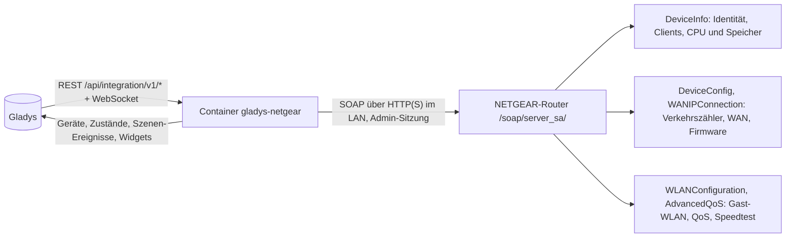
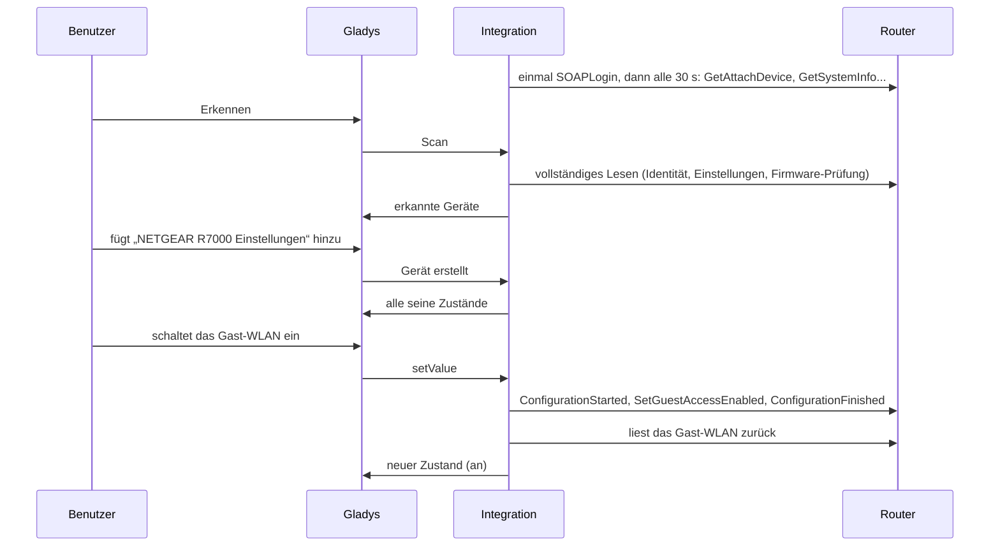
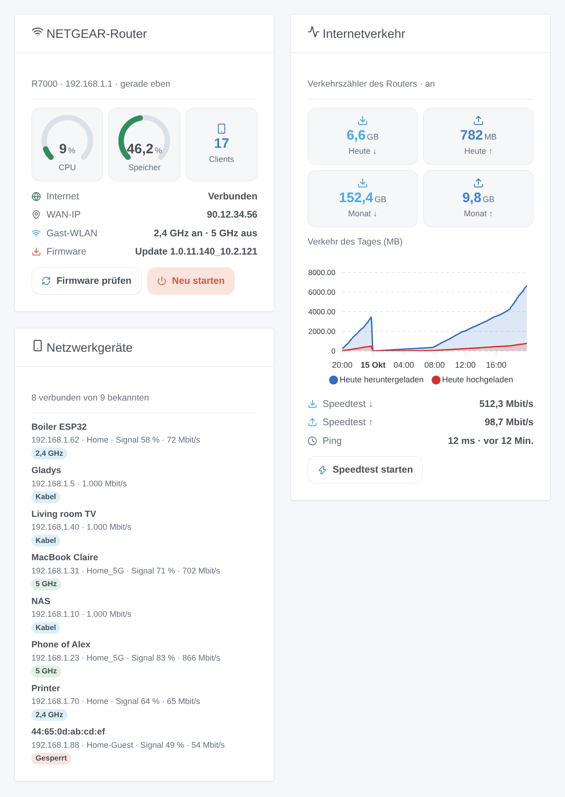

# Gladys NETGEAR

[English](README.md) · [Français](README.fr.md) · **Deutsch** · [Español](README.es.md)

[](LICENSE)
[](https://github.com/William-De71/gladys-netgear/releases)
[](https://github.com/William-De71/gladys-netgear/actions/workflows/release.yml)
[](https://gladysassistant.com)


Externe Integration für [Gladys Assistant](https://gladysassistant.com) für **NETGEAR-Router** (Nighthawk, Orbi und die anderen Router, die die NETGEAR-Apps verwalten): wer in Ihrem Netzwerk ist, der Verkehr des Tages und des Monats, Speedtests, das Gast-WLAN und die übrigen Einstellungen des Routers, Szenen und Dashboard-Widgets. Alles läuft über die lokale API des Routers mit seinem Administratorkonto: keine Cloud.

Benutzerdokumentation: [English](docs/en.md) · [Français](docs/fr.md) · [Deutsch](docs/de.md) · [Español](docs/es.md).

> Community-Integration, nicht mit NETGEAR, Inc. verbunden und nicht von ihr unterstützt.

## Funktionen

- Gerät **Router**: CPU- und Speicherauslastung, heute und diesen Monat herunter- und hochgeladen (Verkehrszähler), letzter Speedtest, Internetstatus, WAN-IP-Adresse, verbundene Clients, Firmware-Version. Jede Gruppe nur, wenn das Modell sie beantwortet.
- Gerät **Einstellungen**: Schalter für Gast-WLAN (2,4 GHz, 5 GHz), Zugangskontrolle, Verkehrszähler, Kindersicherung, QoS und Smart Connect, soweit der Router sie anbietet.
- **Anwesenheit** der Geräte Ihres Netzwerks, aus der Client-Liste des Routers, mit einer Abwesenheitsverzögerung, und ihr **Netzwerkzugang** (erlauben oder sperren) als Schalter.
- **5 Szenen-Auslöser**, **4 Szenen-Aktionen** und **3 Dashboard-Widgets** (unten), und eine Schaltfläche **Diagnose** für Fehlerberichte.
- Überall vier Sprachen: Englisch, Französisch, Deutsch, Spanisch.

## Funktionsweise




Vom Scan bis zum Befehl:



Der Router-Client ist eine JavaScript-Neufassung nach der Python-Bibliothek [pynetgear](https://github.com/MatMaul/pynetgear) (MIT), der Bibliothek der NETGEAR-Integration von Home Assistant: Anmeldung Version 2 (Cookie) oder 1, Port 5000, 80, 443 oder 5555 automatisch gefunden, die zwei Formate der Client-Liste, Methodennamen, die sich von Modell zu Modell unterscheiden.

### Transport

`transports: ["local"]`: Die Integration spricht nur mit der lokalen API des Routers, über HTTP oder HTTPS in Ihrem Netzwerk (das HTTPS-Zertifikat des Routers ist selbstsigniert und wird nicht geprüft). Keine Daten verlassen Ihr Netzwerk; der Router selbst kontaktiert bei einer Firmware-Prüfung den Update-Server von NETGEAR und bei einem Speedtest die Server von Ookla.

## Geräte und Funktionen

| Gerät                 | Funktionen (Kategorie / Typ)                                                                                                                                                                                                                      |
| --------------------- | ------------------------------------------------------------------------------------------------------------------------------------------------------------------------------------------------------------------------------------------------- |
| NETGEAR-Router        | CPU, Speicher (`level-sensor` %), Verkehr heute und diesen Monat (`data` / `size`, MB), Speedtest Download und Upload (`datarate`, Mbit/s) und Ping (`duration`, ms), Internet und WAN-IP (`text`), Clients (`counter-sensor`), Firmware (`text`) |
| NETGEAR-Einstellungen | Gast-WLAN 2,4 / 5 GHz, Zugangskontrolle, Verkehrszähler, Kindersicherung, QoS, Smart Connect (`switch` / `binary`, vom Router zurückgelesene Befehle)                                                                                             |
| Netzwerkgerät         | Anwesenheit (`presence-sensor` / `push`, 1 jede Minute solange anwesend, 0 einmal nach dem Gehen), Netzwerkzugang (`switch` / `binary`, wenn der Router ihn meldet)                                                                               |

Die externen IDs beruhen auf stabilen Kennungen: `main` für den Router und seine Einstellungen, die MAC-Adresse für einen Client.

## Szenen-Auslöser, Aktionen und Widgets



**Widgets**: NETGEAR-Router (CPU- und Speicheranzeige, Clients, Internet, WAN-Adresse, Gast-WLAN, Firmware, Schaltflächen „Firmware prüfen“ und „Neu starten“), Internetverkehr (heute und diesen Monat, Diagramm des Tages sobald das Router-Gerät hinzugefügt ist, letzter Speedtest, Schaltfläche „Speedtest starten“), Netzwerkgeräte (verbunden, gegangen oder alle, mit Verbindung, Signal und einem Badge „Gesperrt“).

**Auslöser**: Internet weg oder zurück, öffentliche IP-Adresse geändert, Gerät gekommen oder gegangen, neues Gerät im Netzwerk (einmal pro MAC-Adresse, in `/data` gespeichert), Firmware-Update verfügbar.

**Aktionen**: Status lesen, Speedtest starten, nach Firmware-Update suchen, neu starten.

Beispiele:

- Wenn Gäste kommen (eine Szenen-Schaltfläche) → Gast-WLAN einschalten; um Mitternacht → wieder aus.
- Um 21 Uhr → die Konsole der Kinder sperren (ihr Schalter „Netzwerkzugang“); um 7 Uhr → wieder erlauben.
- Wenn sich die öffentliche IP-Adresse ändert → sie per Nachricht senden.

Eine Änderung durch Gladys selbst (eine umgeschaltete Einstellung, eine Firmware-Prüfung oder ein Speedtest aus Gladys) löst nie einen Auslöser aus.

## Voraussetzungen

- Gladys Assistant **5.1.0** oder neuer (Widgets und Szenen): ältere Instanzen können die Integration nicht installieren.
- Ein NETGEAR-Router oder Orbi-System mit der lokalen API der NETGEAR-Apps, im Router-Modus, und sein Administratorkonto (`admin` und das Passwort der Weboberfläche).

## Installation

- **Aus dem Store**: Integrationen → NETGEAR → Installieren.
- **Über die Repository-URL**: Integrationen → externe Integration → `https://github.com/William-De71/gladys-netgear`.
- **Entwicklermodus**: `npm start` mit den von Gladys gegebenen Variablen starten (siehe Entwicklung).

## Konfiguration

| Feld                      | Standard    | Bedeutung                                                          |
| ------------------------- | ----------- | ------------------------------------------------------------------ |
| Adresse des Routers       | —           | Seine IP-Adresse, zum Beispiel `192.168.1.1`                       |
| API-Port                  | automatisch | 5000, 80, 443 oder 5555 nacheinander probiert, oder einer davon    |
| Benutzername / Passwort   | `admin` / — | Das Administratorkonto des Routers (das Passwort ist ein `secret`) |
| Leseintervall             | 30 s        | 10 bis 300 s                                                       |
| Angebotene Netzwerkgeräte | mit Namen   | mit Namen, alle, keine                                             |
| Abwesenheitsverzögerung   | 5 Min.      | 1 bis 60 Min.                                                      |
| Sprache der Texte         | automatisch | Namen, Zustände und Szenen-Zusammenfassungen                       |

## Verwendung

1. Konfiguration ausfüllen, dann **Verbindung testen** klicken.
2. **Erkennen**, dann den Router, seine Einstellungen und die gewünschten Netzwerkgeräte hinzufügen.
3. Die Widgets einem Dashboard hinzufügen und Szenen mit den Auslösern und Aktionen bauen.

## Entwicklung

```bash
npm install
npm test                       # node --test, berührt nie das Netzwerk
npm run lint                   # ESLint
npm run format:check           # Prettier
npx github:GladysAssistant/integration-store . --skip-image-check
scripts/build-cover.sh         # cover.jpg aus docs/assets/cover.svg
docs/illustrations/render.sh   # docs/assets/widgets.<lang>.png
```

Lokal liest das SDK `GLADYS_HOST_API_URL`, `GLADYS_INTEGRATION_TOKEN` und `GLADYS_INTEGRATION_SELECTOR` (von Gladys im Entwicklermodus gegeben). `DEBUG=gladys-integration-sdk` zeigt die SDK-Protokolle; Gladys gibt es nicht an eine installierte Integration weiter, daher die Schaltfläche **Diagnose**.

Die Tests decken den SOAP-Client ab (Anmeldeversionen, Port-Erkennung, abgelaufene Sitzung, ausgelasteter Router, falsches Passwort, Rahmen der Schreibvorgänge, Ausweich-Methodennamen), das Lesen der von pynetgear aufgezeichneten Antworten, die Übergänge und die Anwesenheit, die Geräte (die vom Erkennungsbildschirm verlangten Felder), die Widgets (`validateWidgetContent`), Szenen-Ereignisse und -Ausgaben, das Manifest, die vier Sprachen, das Release-Skript und die ganze Integration gegen das Fake-Gladys des SDK und einen Fake-Router. `test/structure.test.js` friert alle Schlüssel ein, die Benutzer speichern.

## Release-Prozess


Jeder Merge auf `main` startet die CI und berechnet dann die Version aus den [Conventional Commits](https://www.conventionalcommits.org/) seit dem letzten Tag: `feat` → Minor, `fix` / `perf` → Patch, `!` oder `BREAKING CHANGE` → Major (unter 1.0.0 ein Minor); `docs`, `chore`, `ci`, `test`, `style`, `refactor`, `build` allein veröffentlichen nichts. Der Changelog-Abschnitt wird erzeugt, der Tag gepusht, das Multi-Architektur-Image gebaut, dann erhält `main` den Release-Commit, die GitHub Release wird erstellt und ein letzter Job prüft das öffentliche Image, den Store-Validator und das Topic.

- Der Titel des Pull Requests wird zum Squash-Commit und dann zur Changelog-Zeile: auf Englisch, für den Benutzer schreiben (`pr-title.yml` prüft ihn). `CHANGELOG.md` nie von Hand bearbeiten.
- 1.0.0 ist eine Entscheidung: Actions → Release → Run workflow mit `release-as: 1.0.0`. `dry-run` zeigt Version und Notizen, ohne zu veröffentlichen.
- **Geschützter Branch**: Das Release pusht seinen Commit mit `GITHUB_TOKEN` auf `main`. Mit einem Ruleset auf `main` GitHub Actions in dessen Bypass-Liste aufnehmen (oder über eine GitHub App pushen), sonst scheitert der Veröffentlichungsjob mit Anweisungen.
- Nach dem ersten Release das Paket auf `ghcr.io` öffentlich machen (Package settings → Change visibility), sonst kann Gladys es nicht laden.

## Fehlerbehebung

Siehe [docs/de.md](docs/de.md#fehlerbehebung). Um ein Problem zu melden, auf **Diagnose** klicken und die Zeilen, die mit `NETGEAR diagnostic` beginnen, aus den Protokollen der Integration kopieren, mit den Versionen von Gladys und der Integration.

## Mitwirken

Issues und Pull Requests sind willkommen. Vor einem Pull Request `npm run format:check && npm run lint && npm test` ausführen und alle externen IDs und gespeicherten Schlüssel unverändert lassen (siehe [CLAUDE.md](CLAUDE.md)).

## Sicherheit

Siehe [SECURITY.md](SECURITY.md): Schwachstellen privat melden. Das Passwort ist ein `secret`-Feld, nie protokolliert und nie in eine URL gesetzt; die Integration meldet sich einmal an, behält ihre Sitzung und wartet nach einem abgelehnten Passwort 5 Minuten. Sie fragt den Router nie nach seinen WLAN-Schlüsseln.

## Kommende Screenshots

Die Bilder oben sind Illustrationen, keine Screenshots. Echte Screenshots kommen nach `docs/assets/screenshots/` (PNG, 1280 × 800): `configuration.png`, `discovery.png`, `devices.png`, `scene.png`.

## Lizenz

[Apache License 2.0](LICENSE) — siehe auch [NOTICE](NOTICE). NETGEAR, Nighthawk und Orbi sind Marken von NETGEAR, Inc.; diese Community-Integration ist nicht mit ihr verbunden. Dank an die Dokumentation und das SDK von Gladys und an die Bibliothek pynetgear.
