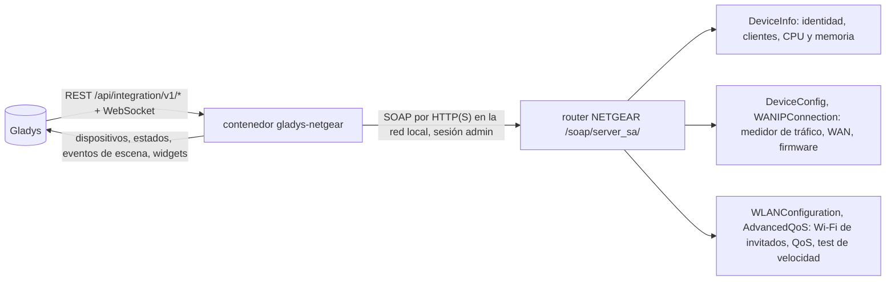
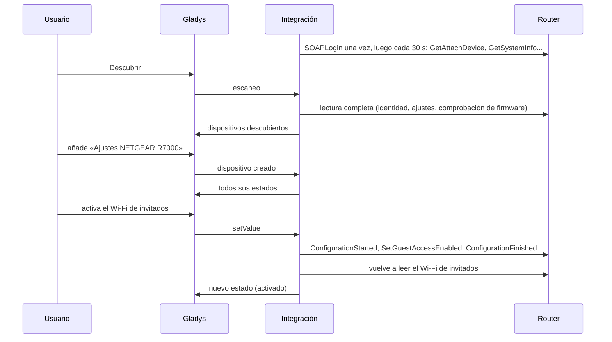
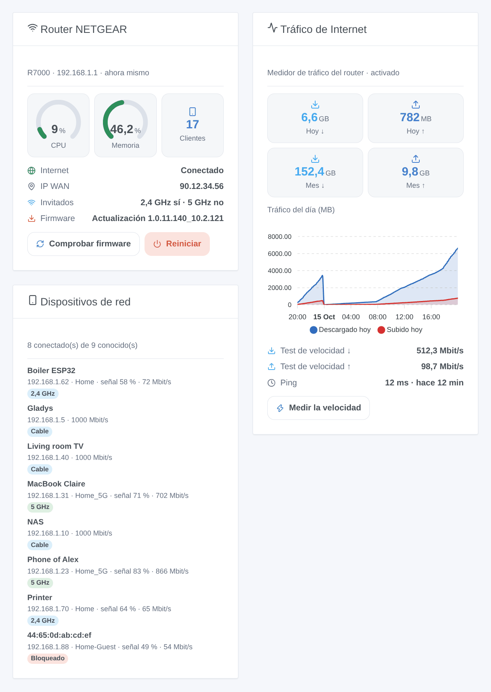

# Gladys NETGEAR

[English](README.md) · [Français](README.fr.md) · [Deutsch](README.de.md) · **Español**

[](LICENSE)
[](https://github.com/William-De71/gladys-netgear/releases)
[](https://github.com/William-De71/gladys-netgear/actions/workflows/release.yml)
[](https://gladysassistant.com)


Integración externa de [Gladys Assistant](https://gladysassistant.com) para **routers NETGEAR** (Nighthawk, Orbi y los demás routers que gestionan las apps de NETGEAR): quién está en su red, el tráfico del día y del mes, tests de velocidad, el Wi-Fi de invitados y los demás ajustes del router, escenas y widgets de panel. Todo pasa por la API local del router, con su cuenta de administrador: sin nube.

Documentación de usuario: [English](docs/en.md) · [Français](docs/fr.md) · [Deutsch](docs/de.md) · [Español](docs/es.md).

> Integración comunitaria, no afiliada ni respaldada por NETGEAR, Inc.

## Funciones

- Dispositivo **router**: uso de CPU y memoria, descargado y subido hoy y este mes (medidor de tráfico), último test de velocidad, estado de Internet, dirección IP WAN, clientes conectados, versión del firmware. Cada grupo solo si el modelo lo responde.
- Dispositivo **ajustes**: interruptores del Wi-Fi de invitados (2,4 GHz, 5 GHz), control de acceso, medidor de tráfico, control parental, QoS y Smart Connect, los que ofrece el router.
- **Presencia** de los dispositivos de su red, a partir de la lista de clientes del router, con un retardo de ausencia, y su **acceso a la red** (permitir o bloquear) como interruptor.
- **5 disparadores**, **4 acciones de escena** y **3 widgets** (abajo), y un botón **Diagnóstico** para los informes de errores.
- Cuatro idiomas en todas partes: inglés, francés, alemán, español.

## Funcionamiento




Del escaneo a un comando:



El cliente del router es una reescritura en JavaScript a partir de la biblioteca Python [pynetgear](https://github.com/MatMaul/pynetgear) (MIT), la de la integración NETGEAR de Home Assistant: inicio de sesión versión 2 (cookie) o 1, puerto 5000, 80, 443 o 5555 encontrado automáticamente, los dos formatos de lista de clientes, nombres de métodos que cambian de un modelo a otro.

### Transporte

`transports: ["local"]`: la integración solo habla con la API local del router, por HTTP o HTTPS en su red (el certificado HTTPS del router es autofirmado y no se comprueba). Ningún dato sale de su red; el propio router contacta con el servidor de actualizaciones de NETGEAR al comprobar el firmware, y con los servidores de Ookla durante un test de velocidad.

## Dispositivos y funciones

| Dispositivo        | Funciones (categoría / tipo)                                                                                                                                                                                                                |
| ------------------ | ------------------------------------------------------------------------------------------------------------------------------------------------------------------------------------------------------------------------------------------- |
| Router NETGEAR     | CPU, memoria (`level-sensor` %), tráfico de hoy y del mes (`data` / `size`, MB), test de velocidad bajada y subida (`datarate`, Mbit/s) y ping (`duration`, ms), Internet e IP WAN (`text`), clientes (`counter-sensor`), firmware (`text`) |
| Ajustes NETGEAR    | Wi-Fi de invitados 2,4 / 5 GHz, control de acceso, medidor de tráfico, control parental, QoS, Smart Connect (`switch` / `binary`, comandos releídos en el router)                                                                           |
| Dispositivo de red | Presencia (`presence-sensor` / `push`, 1 cada minuto mientras está presente, 0 una vez ido), acceso a la red (`switch` / `binary`, si el router lo indica)                                                                                  |

Los identificadores externos se basan en identificadores estables: `main` para el router y sus ajustes, la dirección MAC para un cliente.

## Disparadores, acciones de escena y widgets



**Widgets**: Router NETGEAR (indicadores de CPU y memoria, clientes, Internet, dirección WAN, Wi-Fi de invitados, firmware, botones «Comprobar firmware» y «Reiniciar»), Tráfico de Internet (hoy y este mes, gráfico del día una vez añadido el dispositivo router, último test de velocidad, botón «Medir la velocidad»), Dispositivos de red (conectados, idos o todos, con su conexión, su señal y una etiqueta «Bloqueado»).

**Disparadores**: Internet caído o restablecido, IP pública cambiada, dispositivo llegó o se fue, nuevo dispositivo en la red (una vez por dirección MAC, recordada en `/data`), actualización de firmware disponible.

**Acciones**: leer el estado, medir la velocidad, buscar una actualización de firmware, reiniciar.

Ejemplos:

- Cuando llegan invitados (un botón de escena) → activar el Wi-Fi de invitados; a medianoche → apagarlo.
- A las 21:00 → bloquear la consola de los niños (su interruptor «Acceso a la red»); a las 7:00 → permitirla de nuevo.
- Cuando cambia la IP pública → enviarla por mensaje.

Un cambio hecho por Gladys misma (un ajuste cambiado, una comprobación de firmware o un test de velocidad lanzados desde Gladys) nunca dispara una escena.

## Requisitos

- Gladys Assistant **5.3.0** o posterior (widgets y escenas, palabras clave del catálogo de Gladys 5.3): las instancias más antiguas no pueden instalar la integración.
- Un router NETGEAR o un sistema Orbi con la API local de las apps de NETGEAR, en modo router, y su cuenta de administrador (`admin` y la contraseña de la interfaz web).

## Instalación

- **Desde la tienda**: Integraciones → NETGEAR → Instalar.
- **Desde la URL del repositorio**: Integraciones → integración externa → `https://github.com/William-De71/gladys-netgear`.
- **Modo desarrollador**: ejecute `npm start` con las variables que da Gladys (ver Desarrollo).

## Configuración

| Campo                          | Por defecto | Significado                                                          |
| ------------------------------ | ----------- | -------------------------------------------------------------------- |
| Dirección del router           | —           | Su dirección IP, `192.168.1.1` por ejemplo                           |
| Puerto de la API               | automático  | 5000, 80, 443 o 5555 probados por orden, o uno de ellos              |
| Nombre de usuario / contraseña | `admin` / — | La cuenta de administrador del router (la contraseña es un `secret`) |
| Intervalo de lectura           | 30 s        | De 10 a 300 s                                                        |
| Dispositivos de red ofrecidos  | con nombre  | con nombre, todos, ninguno                                           |
| Retardo de ausencia            | 5 min       | De 1 a 60 min                                                        |
| Idioma de los textos           | automático  | Nombres, estados y resúmenes de escenas                              |

## Uso

1. Rellene la configuración y pulse **Probar la conexión**.
2. **Descubrir**, luego añada el router, sus ajustes y los dispositivos de red que quiera.
3. Añada los widgets a un panel y cree escenas con los disparadores y las acciones.

## Desarrollo

```bash
npm install
npm test                       # node --test, nunca toca la red
npm run lint                   # ESLint
npm run format:check           # Prettier
npx github:GladysAssistant/integration-store . --skip-image-check
scripts/build-cover.sh         # cover.jpg desde docs/assets/cover.svg
docs/illustrations/render.sh   # docs/assets/widgets.<lang>.png
```

En local, el SDK lee `GLADYS_HOST_API_URL`, `GLADYS_INTEGRATION_TOKEN` y `GLADYS_INTEGRATION_SELECTOR` (dados por Gladys en modo desarrollador). `DEBUG=gladys-integration-sdk` muestra los registros del SDK; Gladys no lo pasa a una integración instalada, de ahí el botón **Diagnóstico**.

Las pruebas cubren el cliente SOAP (versiones de inicio de sesión, detección del puerto, sesión caducada, router ocupado, contraseña incorrecta, encuadre de las escrituras, nombres de métodos alternativos), la lectura de las respuestas capturadas por pynetgear, las transiciones y la presencia, los dispositivos (los campos que exige la pantalla de descubrimiento), los widgets (`validateWidgetContent`), los eventos y salidas de escena, el manifiesto, los cuatro idiomas, el script de release, y la integración completa frente al Gladys falso del SDK y un router falso. `test/structure.test.js` congela todas las claves que guardan los usuarios.

## Proceso de release


Cada fusión en `main` lanza la CI y luego calcula la versión a partir de los [Conventional Commits](https://www.conventionalcommits.org/) desde la última etiqueta: `feat` → menor, `fix` / `perf` → parche, `!` o `BREAKING CHANGE` → mayor (una menor por debajo de 1.0.0); `docs`, `chore`, `ci`, `test`, `style`, `refactor`, `build` solos no publican nada. Se genera la sección del changelog, se empuja la etiqueta, se construye la imagen multiarquitectura, luego `main` recibe el commit de release, se crea la GitHub Release y un último job comprueba la imagen pública, el validador de la tienda y el topic.

- El título de la pull request se convierte en el commit squash y luego en la línea del changelog: escríbalo en inglés, para el usuario (`pr-title.yml` lo comprueba). No edite nunca `CHANGELOG.md` a mano.
- La 1.0.0 es una decisión: Actions → Release → Run workflow con `release-as: 1.0.0`. `dry-run` muestra la versión y las notas sin publicar nada.
- **Rama protegida**: la release empuja su commit a `main` con `GITHUB_TOKEN`. Con un ruleset en `main`, añada GitHub Actions a su lista de omisión (o empuje mediante una GitHub App), si no el job de publicación falla con instrucciones.
- Tras la primera release, haga público el paquete de `ghcr.io` (Package settings → Change visibility), si no Gladys no puede descargarlo.

## Solución de problemas

Ver [docs/es.md](docs/es.md#solución-de-problemas). Para informar de un problema, pulse **Diagnóstico** y copie las líneas que empiezan por `NETGEAR diagnostic` de los registros de la integración, con las versiones de Gladys y de la integración.

## Contribuir

Las incidencias y pull requests son bienvenidas. Ejecute `npm run format:check && npm run lint && npm test` antes de abrir una pull request, y mantenga sin cambios todos los identificadores externos y claves guardadas (ver [CLAUDE.md](CLAUDE.md)).

## Seguridad

Ver [SECURITY.md](SECURITY.md): informe de las vulnerabilidades en privado. La contraseña es un campo `secret`, nunca registrado ni puesto en una URL; la integración inicia sesión una vez, conserva su sesión y espera 5 minutos tras una contraseña rechazada. Nunca pide al router sus claves Wi-Fi.

## Capturas por venir

Las imágenes de arriba son ilustraciones, no capturas de pantalla. Las capturas reales irán en `docs/assets/screenshots/` (PNG, 1280 × 800): `configuration.png`, `discovery.png`, `devices.png`, `scene.png`.

## Licencia

[Licencia Apache 2.0](LICENSE) — ver también [NOTICE](NOTICE). NETGEAR, Nighthawk y Orbi son marcas de NETGEAR, Inc.; esta integración comunitaria no está afiliada a ella. Gracias a la documentación y al SDK de Gladys, y a la biblioteca pynetgear.
