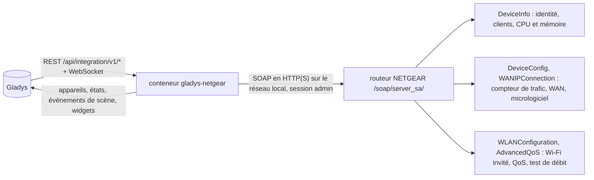
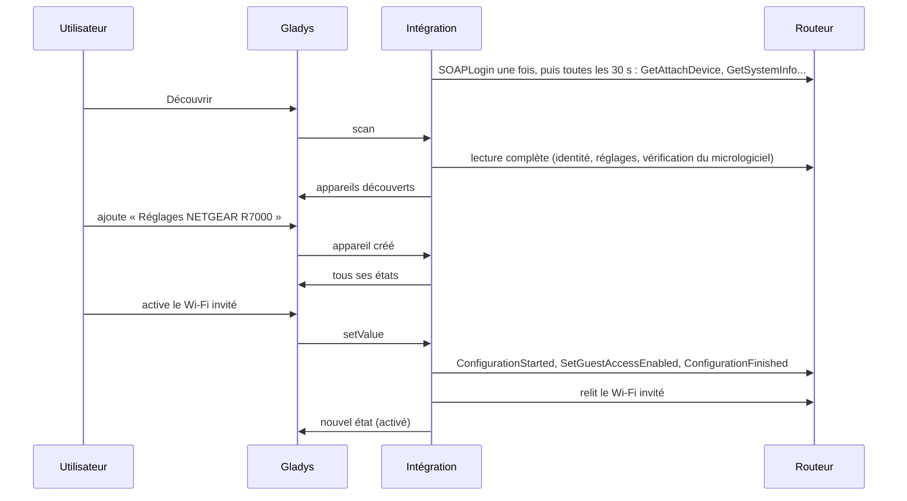
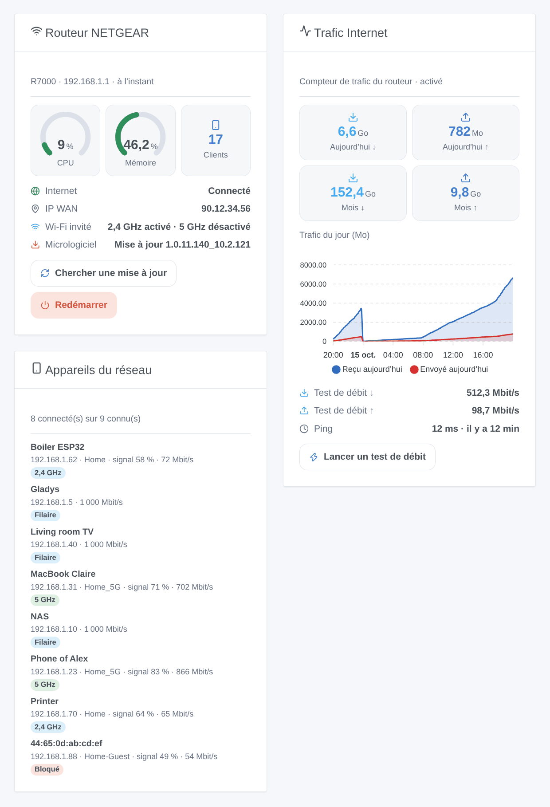

# Gladys NETGEAR

[English](README.md) · **Français** · [Deutsch](README.de.md) · [Español](README.es.md)

[](LICENSE)
[](https://github.com/William-De71/gladys-netgear/releases)
[](https://github.com/William-De71/gladys-netgear/actions/workflows/release.yml)
[](https://gladysassistant.com)


Intégration externe de [Gladys Assistant](https://gladysassistant.com) pour les **routeurs NETGEAR** (Nighthawk, Orbi et les autres routeurs que pilotent les applications NETGEAR) : qui est sur votre réseau, le trafic du jour et du mois, les tests de débit, le Wi-Fi invité et les autres réglages du routeur, des scènes et des widgets de tableau de bord. Tout passe par l’API locale du routeur, avec son compte administrateur : aucun cloud.

Documentation utilisateur : [English](docs/en.md) · [Français](docs/fr.md) · [Deutsch](docs/de.md) · [Español](docs/es.md).

> Intégration communautaire, ni affiliée à NETGEAR, Inc., ni approuvée par elle.

## Fonctionnalités

- Appareil **routeur** : utilisation CPU et mémoire, reçu et envoyé aujourd’hui et ce mois-ci (compteur de trafic), dernier test de débit, état d’Internet, adresse IP WAN, clients connectés, version du micrologiciel. Chaque groupe seulement si le modèle y répond.
- Appareil **réglages** : interrupteurs du Wi-Fi invité (2,4 GHz, 5 GHz), du contrôle d’accès, du compteur de trafic, du contrôle parental, de la QoS et de Smart Connect, ceux que propose le routeur.
- **Présence** des appareils de votre réseau, d’après la liste des clients du routeur, avec un délai d’absence, et leur **accès au réseau** (autoriser ou bloquer) sous forme d’interrupteur.
- **5 déclencheurs**, **4 actions de scène** et **3 widgets** (ci-dessous), et un bouton **Diagnostic** pour les rapports de bug.
- Quatre langues partout : anglais, français, allemand, espagnol.

## Fonctionnement




De la découverte à une commande :



Le client du routeur est une réécriture en JavaScript d’après la bibliothèque Python [pynetgear](https://github.com/MatMaul/pynetgear) (MIT), celle de l’intégration NETGEAR de Home Assistant : connexion version 2 (cookie) ou 1, port 5000, 80, 443 ou 5555 trouvé automatiquement, les deux formats de liste des clients, des noms de méthodes qui changent d’un modèle à l’autre.

### Transport

`transports: ["local"]` : l’intégration ne dialogue qu’avec l’API locale du routeur, en HTTP ou HTTPS sur votre réseau (le certificat HTTPS du routeur est auto-signé et n’est pas vérifié). Aucune donnée ne quitte votre réseau ; le routeur contacte lui-même le serveur de mises à jour NETGEAR lors d’une vérification, et les serveurs Ookla lors d’un test de débit.

## Appareils et fonctionnalités

| Appareil           | Fonctionnalités (catégorie / type)                                                                                                                                                                                                                   |
| ------------------ | ---------------------------------------------------------------------------------------------------------------------------------------------------------------------------------------------------------------------------------------------------- |
| Routeur NETGEAR    | CPU, mémoire (`level-sensor` %), trafic du jour et du mois (`data` / `size`, Mo), test de débit descendant et montant (`datarate`, Mbit/s) et ping (`duration`, ms), Internet et IP WAN (`text`), clients (`counter-sensor`), micrologiciel (`text`) |
| Réglages NETGEAR   | Wi-Fi invité 2,4 / 5 GHz, contrôle d’accès, compteur de trafic, contrôle parental, QoS, Smart Connect (`switch` / `binary`, commandes relues sur le routeur)                                                                                         |
| Appareil du réseau | Présence (`presence-sensor` / `push`, 1 chaque minute tant qu’il est présent, 0 une fois parti), accès au réseau (`switch` / `binary`, si le routeur l’indique)                                                                                      |

Les identifiants externes reposent sur des identifiants stables : `main` pour le routeur et ses réglages, l’adresse MAC pour un client.

## Déclencheurs, actions de scène et widgets



**Widgets** : Routeur NETGEAR (jauges CPU et mémoire, clients, Internet, adresse WAN, Wi-Fi invité, micrologiciel, boutons « Chercher une mise à jour » et « Redémarrer »), Trafic Internet (aujourd’hui et ce mois-ci, graphique du jour une fois l’appareil routeur ajouté, dernier test de débit, bouton « Lancer un test de débit »), Appareils du réseau (connectés, partis ou tous, avec leur connexion, leur signal et un badge « Bloqué »).

**Déclencheurs** : Internet coupé ou rétabli, adresse IP publique changée, appareil arrivé ou parti, nouvel appareil sur le réseau (une fois par adresse MAC, mémorisée dans `/data`), mise à jour du micrologiciel disponible.

**Actions** : lire l’état, lancer un test de débit, vérifier les mises à jour, redémarrer.

Exemples :

- Quand des invités arrivent (un bouton de scène) → activer le Wi-Fi invité ; à minuit → le couper.
- À 21 h → bloquer la console des enfants (son interrupteur « Accès au réseau ») ; à 7 h → la réautoriser.
- Quand l’adresse IP publique change → l’envoyer par message.

Un changement fait par Gladys elle-même (un réglage basculé, une vérification de mise à jour ou un test de débit lancés depuis Gladys) ne déclenche jamais de scène.

## Prérequis

- Gladys Assistant **5.3.0** ou plus récent (widgets et scènes, mots-clés du catalogue de Gladys 5.3) : les instances plus anciennes ne peuvent pas installer l’intégration.
- Un routeur NETGEAR ou un système Orbi doté de l’API locale des applications NETGEAR, en mode routeur, et son compte administrateur (`admin` et le mot de passe de l’interface web).

## Installation

- **Depuis le store** : Intégrations → NETGEAR → Installer.
- **Depuis l’URL du dépôt** : Intégrations → intégration externe → `https://github.com/William-De71/gladys-netgear`.
- **Mode développeur** : lancez `npm start` avec les variables données par Gladys (voir Développement).

## Configuration

| Champ                            | Défaut      | Signification                                                         |
| -------------------------------- | ----------- | --------------------------------------------------------------------- |
| Adresse du routeur               | —           | Son adresse IP, `192.168.1.1` par exemple                             |
| Port de l’API                    | automatique | 5000, 80, 443 ou 5555 essayés tour à tour, ou l’un d’eux              |
| Nom d’utilisateur / mot de passe | `admin` / — | Le compte administrateur du routeur (le mot de passe est un `secret`) |
| Intervalle de lecture            | 30 s        | De 10 à 300 s                                                         |
| Appareils du réseau proposés     | avec un nom | avec un nom, tous, aucun                                              |
| Délai d’absence                  | 5 min       | De 1 à 60 min                                                         |
| Langue des textes                | automatique | Noms, états et résumés des scènes                                     |

## Utilisation

1. Remplissez la configuration, puis cliquez sur **Tester la connexion**.
2. **Découvrir**, puis ajoutez le routeur, ses réglages et les appareils du réseau voulus.
3. Ajoutez les widgets à un tableau de bord, et créez des scènes avec les déclencheurs et les actions.

## Développement

```bash
npm install
npm test                       # node --test, ne touche jamais le réseau
npm run lint                   # ESLint
npm run format:check           # Prettier
npx github:GladysAssistant/integration-store . --skip-image-check
scripts/build-cover.sh         # cover.jpg depuis docs/assets/cover.svg
docs/illustrations/render.sh   # docs/assets/widgets.<lang>.png
```

En local, le SDK lit `GLADYS_HOST_API_URL`, `GLADYS_INTEGRATION_TOKEN` et `GLADYS_INTEGRATION_SELECTOR` (donnés par Gladys en mode développeur). `DEBUG=gladys-integration-sdk` affiche les journaux du SDK ; Gladys ne le transmet pas à une intégration installée, d’où le bouton **Diagnostic**.

Les tests couvrent le client SOAP (versions de connexion, détection du port, session expirée, routeur occupé, mauvais mot de passe, encadrement des écritures, noms de méthodes de repli), la lecture des réponses capturées par pynetgear, les transitions et la présence, les appareils (les champs qu’exige l’écran de découverte), les widgets (`validateWidgetContent`), les événements et sorties de scène, le manifeste, les quatre langues, le script de release, et l’intégration entière face au faux Gladys du SDK et à un faux routeur. `test/structure.test.js` fige toutes les clés que les utilisateurs enregistrent.

## Processus de release


Chaque fusion sur `main` lance la CI, puis calcule la version d’après les [Conventional Commits](https://www.conventionalcommits.org/) depuis le dernier tag : `feat` → mineure, `fix` / `perf` → correctif, `!` ou `BREAKING CHANGE` → majeure (une mineure tant qu’on est sous 1.0.0) ; `docs`, `chore`, `ci`, `test`, `style`, `refactor`, `build` seuls ne publient rien. La section du changelog est générée, le tag poussé, l’image multi-architecture construite, puis `main` reçoit le commit de release, la GitHub Release est créée et un dernier job vérifie l’image publique, le validateur du store et le topic.

- Le titre de la pull request devient le commit squash, puis la ligne du changelog : écrivez-le en anglais, pour l’utilisateur (`pr-title.yml` le vérifie). N’éditez jamais `CHANGELOG.md` à la main.
- La 1.0.0 est une décision : Actions → Release → Run workflow avec `release-as: 1.0.0`. `dry-run` affiche la version et les notes sans rien publier.
- **Branche protégée** : la release pousse son commit sur `main` avec `GITHUB_TOKEN`. Avec un ruleset sur `main`, ajoutez GitHub Actions à sa liste de contournement (ou poussez via une GitHub App), sinon le job de publication échoue avec des instructions.
- Après la première release, rendez public le package `ghcr.io` (Package settings → Change visibility), sinon Gladys ne peut pas le télécharger.

## Dépannage

Voir [docs/fr.md](docs/fr.md#dépannage). Pour signaler un problème, cliquez sur **Diagnostic** et copiez les lignes commençant par `NETGEAR diagnostic` dans les journaux de l’intégration, avec les versions de Gladys et de l’intégration.

## Contribuer

Les tickets et pull requests sont bienvenus. Lancez `npm run format:check && npm run lint && npm test` avant d’ouvrir une pull request, et gardez inchangés tous les identifiants externes et clés enregistrées (voir [CLAUDE.md](CLAUDE.md)).

## Sécurité

Voir [SECURITY.md](SECURITY.md) : signalez les vulnérabilités en privé. Le mot de passe est un champ `secret`, jamais journalisé ni mis dans une URL ; l’intégration se connecte une fois, garde sa session, et attend 5 minutes après un mot de passe refusé. Elle ne demande jamais ses clés Wi-Fi au routeur.

## Captures à venir

Les images ci-dessus sont des illustrations, pas des captures d’écran. Les vraies captures iront dans `docs/assets/screenshots/` (PNG, 1280 × 800) : `configuration.png`, `discovery.png`, `devices.png`, `scene.png`.

## Licence

[Licence Apache 2.0](LICENSE) — voir aussi [NOTICE](NOTICE). NETGEAR, Nighthawk et Orbi sont des marques de NETGEAR, Inc. ; cette intégration communautaire ne lui est pas affiliée. Merci à la documentation et au SDK de Gladys, et à la bibliothèque pynetgear.
