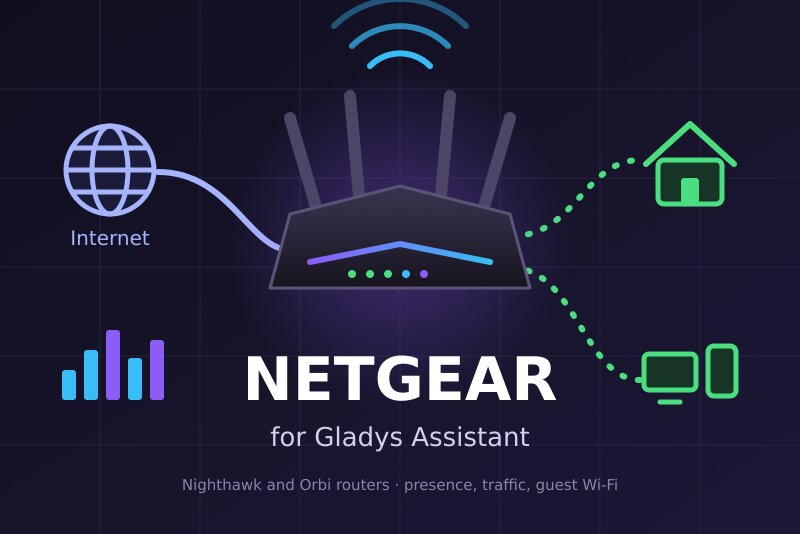
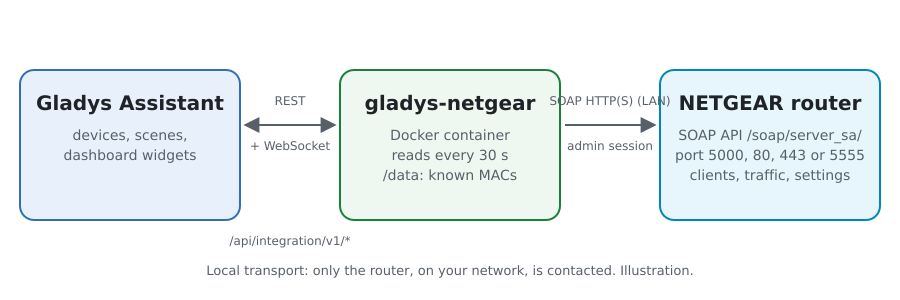
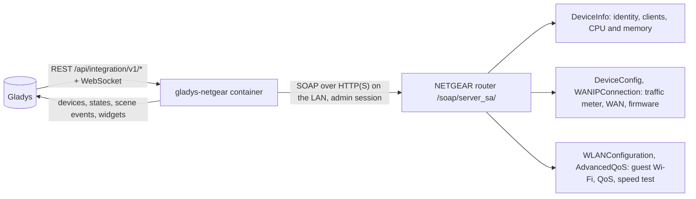
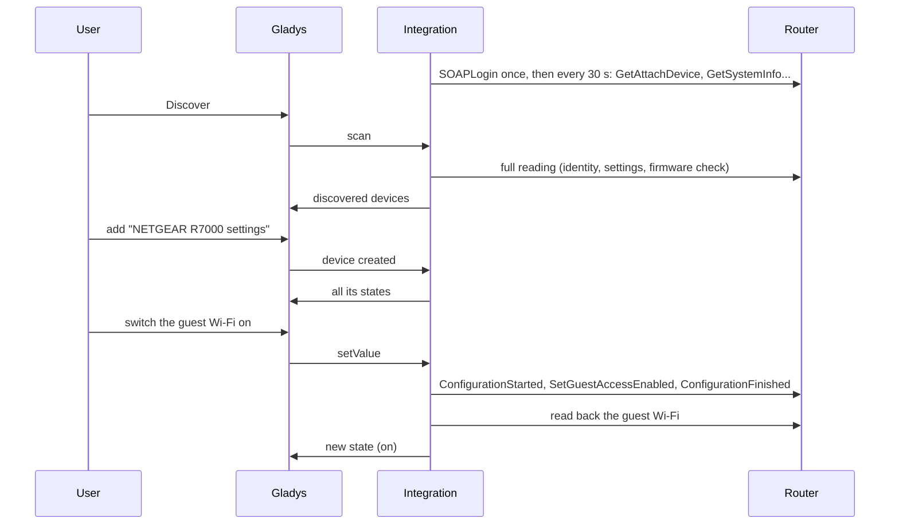
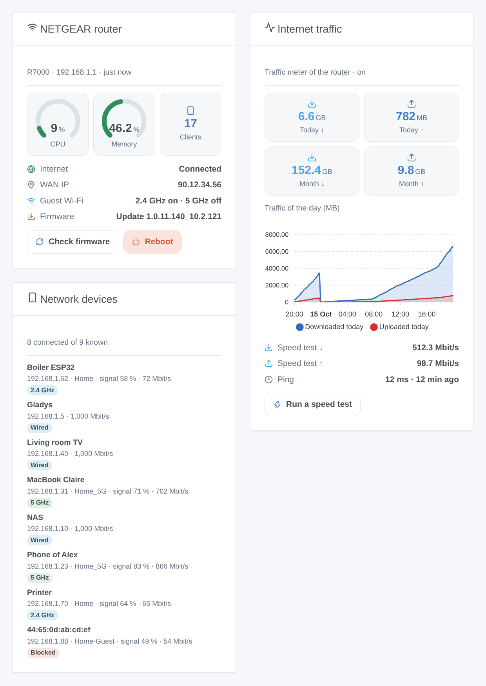

# Gladys NETGEAR

**English** · [Français](README.fr.md) · [Deutsch](README.de.md) · [Español](README.es.md)

[](LICENSE)
[](https://github.com/William-De71/gladys-netgear/releases)
[](https://github.com/William-De71/gladys-netgear/actions/workflows/release.yml)
[](https://gladysassistant.com)



[Gladys Assistant](https://gladysassistant.com) external integration for **NETGEAR routers** (Nighthawk, Orbi and the other routers the NETGEAR apps manage): who is on your network, the traffic of the day and of the month, speed tests, the guest Wi-Fi and the other router settings, scenes and dashboard widgets. Everything goes through the local API of the router, with its administrator account: no cloud.

User documentation: [English](docs/en.md) · [Français](docs/fr.md) · [Deutsch](docs/de.md) · [Español](docs/es.md).

> Community integration, not affiliated with nor endorsed by NETGEAR, Inc.

## Features

- **Router** device: CPU and memory usage, downloaded and uploaded today and this month (traffic meter), last speed test, internet status, WAN IP address, connected clients, firmware version. Each group only when the model answers it.
- **Settings** device: switches for the guest Wi-Fi (2.4 GHz, 5 GHz), access control, traffic meter, parental control, QoS and Smart Connect, those the router offers.
- **Presence** of the devices of your network, from the client list of the router, with an absence delay, and their **network access** (allow or block) as a switch.
- **5 scene triggers**, **4 scene actions** and **3 dashboard widgets** (below), and a **Diagnostic** button for bug reports.
- Four languages everywhere: English, French, German, Spanish.

## How it works





From the scan to a command:



The router client is a JavaScript rewrite after the [pynetgear](https://github.com/MatMaul/pynetgear) Python library (MIT), the library of the Home Assistant NETGEAR integration: login version 2 (cookie) or 1, port 5000, 80, 443 or 5555 found automatically, the two client list formats, method names that differ between models.

### Transport

`transports: ["local"]`: the integration only talks to the local API of the router, over HTTP or HTTPS on your network (the HTTPS certificate of the router is self-signed and not checked). No data leaves your network; the router itself contacts the NETGEAR update server during a firmware check, and the Ookla servers during a speed test.

## Devices and features

| Device           | Features (category / type)                                                                                                                                                                                                             |
| ---------------- | -------------------------------------------------------------------------------------------------------------------------------------------------------------------------------------------------------------------------------------- |
| NETGEAR router   | CPU, memory (`level-sensor` %), traffic today and this month (`data` / `size`, MB), speed test down and up (`datarate`, Mbit/s) and ping (`duration`, ms), internet and WAN IP (`text`), clients (`counter-sensor`), firmware (`text`) |
| NETGEAR settings | Guest Wi-Fi 2.4 / 5 GHz, access control, traffic meter, parental control, QoS, Smart Connect (`switch` / `binary`, commands read back from the router)                                                                                 |
| Network device   | Presence (`presence-sensor` / `push`, 1 every minute while present, 0 once gone), network access (`switch` / `binary`, when the router reports it)                                                                                     |

External ids rest on stable identifiers: `main` for the router and its settings, the MAC address for a client.

## Scene triggers, actions and widgets



**Widgets**: NETGEAR router (CPU and memory gauges, clients, internet, WAN address, guest Wi-Fi, firmware, "check firmware" and "reboot" buttons), Internet traffic (today and this month, chart of the day once the router device is added, last speed test, "run a speed test" button), Network devices (connected, gone or all, with their connection, signal and a "Blocked" badge).

**Triggers**: internet down or back, public IP address changed, device arrived or left, new device on the network (once per MAC address, remembered in `/data`), firmware update available.

**Actions**: read the status, run a speed test, check for a firmware update, reboot.

Examples:

- When guests arrive (a scene button) → turn the guest Wi-Fi on; at midnight → off again.
- At 21:00 → block the console of the children (its "Network access" switch); at 7:00 → allow it again.
- When the public IP address changes → send it by message.

A change made by Gladys itself (a setting switched, a firmware check or a speed test run from Gladys) never fires a trigger.

## Requirements

- Gladys Assistant **5.1.0** or later (widgets and scenes): older instances cannot install the integration.
- A NETGEAR router or Orbi system with the local API of the NETGEAR apps, in router mode, and its administrator account (`admin` and the password of the web interface).

## Installation

- **From the store**: Integrations → NETGEAR → Install.
- **From the repository URL**: Integrations → external integration → `https://github.com/William-De71/gladys-netgear`.
- **Developer mode**: run `npm start` with the variables given by Gladys (see Development).

## Configuration

| Field                   | Default     | Meaning                                                              |
| ----------------------- | ----------- | -------------------------------------------------------------------- |
| Router address          | —           | Its IP address, `192.168.1.1` for example                            |
| API port                | automatic   | 5000, 80, 443 or 5555 tried in turn, or one of them                  |
| User name / Password    | `admin` / — | The administrator account of the router (the password is a `secret`) |
| Reading interval        | 30 s        | 10 to 300 s                                                          |
| Network devices offered | with a name | with a name, all, none                                               |
| Absence delay           | 5 min       | 1 to 60 min                                                          |
| Language of the texts   | automatic   | Names, states and scene summaries                                    |

## Usage

1. Fill in the configuration, then click **Test the connection**.
2. **Discover**, then add the router, its settings and the network devices you want.
3. Add the widgets to a dashboard, and build scenes with the triggers and actions.

## Development

```bash
npm install
npm test                       # node --test, never touches the network
npm run lint                   # ESLint
npm run format:check           # Prettier
npx github:GladysAssistant/integration-store . --skip-image-check
scripts/build-cover.sh         # cover.jpg from docs/assets/cover.svg
docs/illustrations/render.sh   # docs/assets/widgets.<lang>.png
```

Locally, the SDK reads `GLADYS_HOST_API_URL`, `GLADYS_INTEGRATION_TOKEN` and `GLADYS_INTEGRATION_SELECTOR` (given by Gladys in developer mode). `DEBUG=gladys-integration-sdk` shows the SDK logs; Gladys does not pass it to an installed integration, hence the **Diagnostic** button.

The tests cover the SOAP client (login versions, port detection, expired session, busy router, wrong password, write framing, method name fallbacks), the parsing of the answers captured by pynetgear, the transitions and the presence, the devices (the fields the Discovery screen requires), the widgets (`validateWidgetContent`), the scene events and outputs, the manifest, the four languages, the release script, and the whole integration against the fake Gladys of the SDK and a fake router. `test/structure.test.js` freezes every key users store.

## Release process


Every merge on `main` runs the CI, then computes the version from the [Conventional Commits](https://www.conventionalcommits.org/) since the last tag: `feat` → minor, `fix` / `perf` → patch, `!` or `BREAKING CHANGE` → major (a minor below 1.0.0); `docs`, `chore`, `ci`, `test`, `style`, `refactor`, `build` alone publish nothing. The changelog section is generated, the tag pushed, the multi-architecture image built, then `main` receives the release commit, the GitHub Release is created and a last job checks the public image, the store validator and the topic.

- The pull request title becomes the squash commit, then the changelog line: write it in English, for the user (`pr-title.yml` checks it). Never edit `CHANGELOG.md` by hand.
- 1.0.0 is a decision: Actions → Release → Run workflow with `release-as: 1.0.0`. `dry-run` shows the version and the notes without publishing.
- **Protected branch**: the release pushes its commit to `main` with `GITHUB_TOKEN`. With a ruleset on `main`, add GitHub Actions to its bypass list (or push through a GitHub App), otherwise the publish job fails with instructions.
- After the first release, make the `ghcr.io` package public (Package settings → Change visibility), or Gladys cannot pull it.

## Troubleshooting

See [docs/en.md](docs/en.md#troubleshooting). To report a problem, click **Diagnostic** and copy the lines starting with `NETGEAR diagnostic` from the logs of the integration, with the versions of Gladys and of the integration.

## Contributing

Issues and pull requests are welcome. Run `npm run format:check && npm run lint && npm test` before opening a pull request, and keep every external id and stored key unchanged (see [CLAUDE.md](CLAUDE.md)).

## Security

See [SECURITY.md](SECURITY.md): report vulnerabilities privately. The password is a `secret` field, never logged nor put in an URL; the integration logs in once, keeps its session, and waits 5 minutes after a refused password. It never asks the router for its Wi-Fi keys.

## Screenshots to come

The images above are illustrations, not screenshots. Real screenshots will go in `docs/assets/screenshots/` (PNG, 1280 × 800): `configuration.png`, `discovery.png`, `devices.png`, `scene.png`.

## License

[Apache License 2.0](LICENSE) — see also [NOTICE](NOTICE). NETGEAR, Nighthawk and Orbi are trademarks of NETGEAR, Inc.; this community integration is not affiliated with it. Thanks to the Gladys documentation and SDK, and to the pynetgear library.
